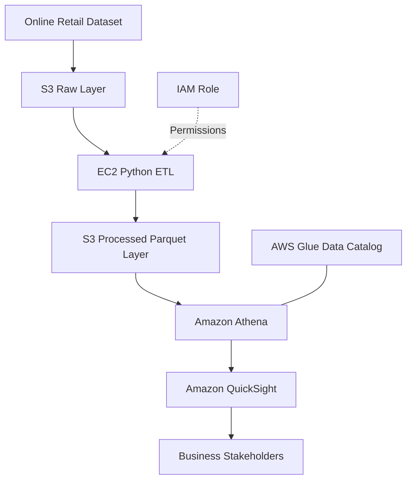
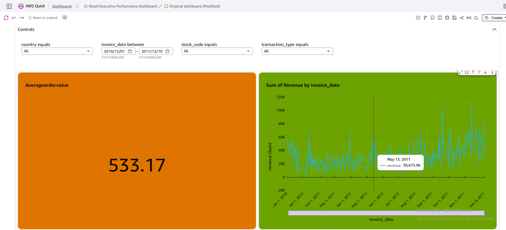

# AWS Retail Analytics Pipeline

An end-to-end cloud-based retail analytics solution integrating Amazon S3, EC2, Athena and QuickSight to transform raw transaction data into actionable business intelligence.

## Business Objective

Develop a scalable cloud analytics architecture that automates data preparation, enables efficient SQL querying and supports interactive executive reporting.

## Architecture



## Technology Stack

- Amazon S3 — Cloud object storage
- Amazon EC2 — Cloud computation
- Python, Pandas, Boto3 and PyArrow — ETL and data transformation
- Amazon Athena — Serverless SQL analytics
- AWS Glue Data Catalog — Metadata management
- Amazon QuickSight — Business intelligence
- AWS IAM — Access control
- Git and GitHub — Version control

## Dataset

UCI Online Retail Dataset

Source: https://archive.ics.uci.edu/dataset/352/online+retail

The dataset contains approximately 541,909 historical retail transaction records, including product, customer, quantity, price and country information.

## Data Engineering Pipeline

1. Store raw transaction data in Amazon S3.
2. Extract the dataset using Python on Amazon EC2.
3. Validate records, standardize fields and derive business metrics.
4. Convert processed data to compressed Parquet format.
5. Upload processed data to the S3 analytics layer.
6. Define external tables using Amazon Athena and Glue Data Catalog.
7. Connect the analytical dataset to Amazon QuickSight.
8. Publish interactive business intelligence dashboards.

## Business KPIs

- Gross sales and net revenue
- Total sales orders
- Distinct customers
- Average order value
- Monthly revenue growth
- Country-level sales performance
- Top-performing products
- Return-to-sales ratio
- Customer segmentation

## Performance Benchmark

| Metric | Result |
|---|---|
| Original records | To be measured |
| Processed records | To be measured |
| Duplicate records removed | To be measured |
| Storage reduction | To be measured |
| Athena data scan reduction | To be measured |
| Query latency reduction | To be measured |
| ETL execution time | To be measured |

Performance results are based on recorded execution statistics and reproducible SQL benchmarks.

## Dashboard



## Security

- IAM-based service authentication
- Restricted S3 access
- Default S3 encryption
- No hardcoded AWS credentials
- Private S3 data storage
- Budget monitoring

## Reproduction

Install the dependencies:

```bash
pip install -r requirements.txt
```

Run the ETL pipeline using an authorized AWS identity:

```bash
python src/etl.py --bucket YOUR_BUCKET
```

Execute the SQL files in Athena and connect the processed dataset to QuickSight.

## Limitations

The project uses historical retail data and scheduled batch processing. It demonstrates on-demand access to processed business data rather than a true real-time streaming architecture.

## Future Enhancements

- Incremental data ingestion
- Partitioned Parquet datasets
- Event-driven ETL
- Automated data quality testing
- Infrastructure as Code using Terraform
- CI/CD using GitHub Actions
